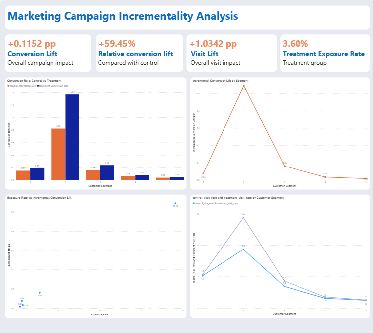

# MARKETING-CAMPAIGN-INCREMENTALITY-ANALYSIS---PYTHON-SQL-DUCKDB-PANDAS-SCIPY-POWER-BI-

**Measuring the true incremental impact of digital advertising campaigns using experimental data.**

---

## 📋 Table of Contents
- [1. Project Overview](#1-project-overview)
- [2. Business Problem](#2-business-problem)
- [3. Tools & Technologies](#3-tools--technologies)
- [4. Key Findings](#4-key-findings)
- [5. Methodology](#5-methodology)
- [6. Power BI Dashboard](#6-power-bi-dashboard)
- [7. Business Recommendations](#7-business-recommendations)
- [8. Limitations](#8-limitations)
- [9. Repository Structure](#9-repository-structure)
- [10. Dataset](#10-dataset)

---

## 1. Project Overview

This project evaluates the effectiveness of a digital advertising campaign using the **Criteo Uplift Modeling Dataset**.

The objective is to determine whether the campaign generated additional customer visits and conversions by comparing customers assigned to treatment and control groups. Rather than relying on total conversions alone, the analysis focuses on **incrementality** — measuring the difference in outcomes between the two groups to assess campaign performance.

---

## 2. Business Problem

Marketing teams need to understand whether advertising campaigns generate additional conversions or simply reach customers who would have converted anyway.

**Key Questions Addressed:**
* Did the campaign improve customer conversion and visit rates?
* Which customer segments demonstrated the strongest observed response?
* How did actual advertising exposure vary across customer segments?

---

## 3. Tools & Technologies

| Tool | Purpose |
| :--- | :--- |
| **Python** | Data analysis and statistical calculations |
| **SQL** | Data querying and analysis |
| **DuckDB** | Large-scale analytical queries |
| **Pandas** | Data manipulation |
| **SciPy** | Statistical hypothesis testing |
| **Google Colab** | Development environment |
| **Power BI** | Interactive dashboard and visualization |

---

## 4. Key Findings

### Overall Campaign Performance

| Metric | Result |
| :--- | ---: |
| **Control Conversion Rate** | 0.1938% |
| **Treatment Conversion Rate** | 0.3089% |
| **Incremental Conversion Lift** | **+0.1152 percentage points** |
| **Relative Conversion Lift** | **+59.45%** |
| **Incremental Visit Lift** | **+1.0342 percentage points** |
| **Estimated Incremental Conversions** | ~13,687 |
| **Treatment Group Exposure Rate** | 3.60% |

### Key Segment-Level Insights
* **Top Conversion Lift:** Segment 2 recorded the highest conversion lift at **+0.5441 percentage points**.
* **Top Visit Lift:** Segment 2 also recorded the highest visit lift at approximately **+5.0644 percentage points**.
* **Exposure Concentration:** Segment 2 had an advertising exposure rate of **19.11%**, substantially higher than the other segments.
* **Statistical Significance:** Four of the five segments showed statistically significant conversion-rate differences at the Bonferroni-adjusted `0.01` significance threshold.

*Note: Estimated incremental conversions are calculated by applying the observed conversion-rate difference to the treatment group size and do not represent individually identified campaign-generated conversions.*

---

## 5. Methodology

The project followed an end-to-end analytical workflow:

1. **Data Inspection & Quality Checks** – Examined dataset structure, missing values, binary variables, and logical consistency.
2. **Exploratory Data Analysis** – Analyzed treatment assignment, customer features, visits, conversions, and advertising exposure.
3. **Incrementality Measurement** – Calculated conversion rates, visit rates, absolute lift, and relative lift.
4. **Statistical Testing** – Applied two-proportion z-tests and confidence intervals to assess observed treatment-control differences.
5. **Customer Segmentation** – Divided customers into five groups using the anonymized feature `f0` and evaluated segment-level performance.
6. **Exposure Analysis** – Investigated actual advertising exposure across treatment-group segments.
7. **Dashboard Development** – Created an interactive Power BI dashboard to communicate campaign performance and business insights.

---

## 6. Power BI Dashboard

The dashboard presents the main campaign performance metrics and customer segment findings.

**Dashboard Highlights:**
* Control vs. Treatment Conversion Rate
* Incremental Conversion Lift by Segment
* Control vs. Treatment Visit Rate
* Exposure Rate vs. Conversion Lift
* Overall campaign performance KPIs

---

## 7. Business Recommendations

* **Investigate High-Performing Segments:** Analyze high-performing customer segments to understand differences in observed campaign response.
* **Audit Ad Delivery & Exposure:** Evaluate advertising delivery and exposure across segments before optimizing targeting strategies.
* **Prioritize Incremental Metrics:** Use incremental lift rather than total conversions alone when evaluating campaign effectiveness.
* **Maintain Controlled Experimentation:** Continue controlled experimentation to support reliable marketing investment decisions.

---

## 8. Limitations

* **Anonymized Features:** Customer features are anonymized, so their real-world meanings cannot be determined.
* **Unverified Randomization:** The treatment assignment mechanism and randomization process have not been independently verified.
* **Non-Causal Exposure Comparisons:** Actual advertising exposure is not equivalent to randomized treatment assignment; exposed vs. unexposed comparisons are descriptive, not causal.
* **Missing Financial Data:** Revenue and campaign cost data are unavailable, so ROI, ROAS, and profitability cannot be calculated.

---

## 9. Dataset
Source: Criteo Uplift Modeling Dataset – Kaggle

Scale: ~13.98 million customer records and 16 columns, including anonymized customer features, treatment assignment, conversion, visit, and advertising exposure.

Project Focus: Marketing Analytics | Campaign Incrementality | A/B Testing | Statistical Analysis | Customer Segmentation | Business Intelligence
